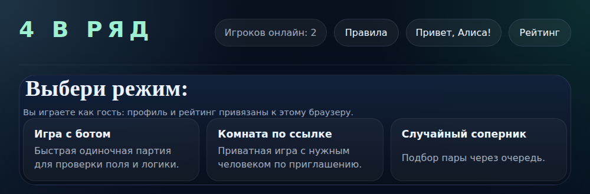
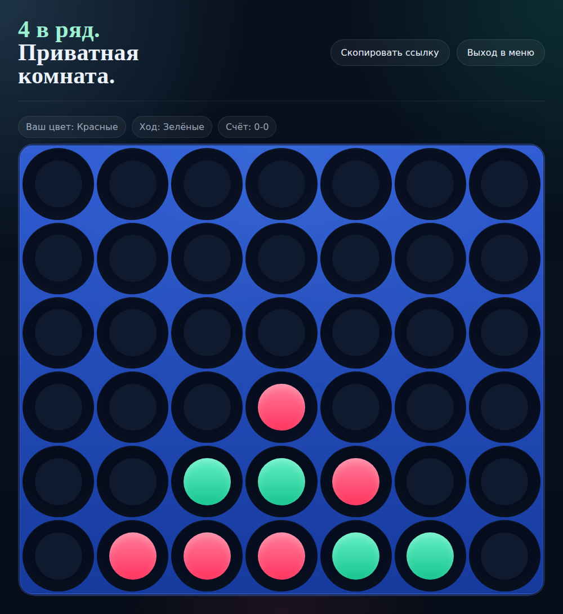
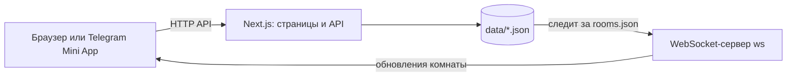

# Connect Four (4 в ряд)

[Русский](#русский) · [English](#english)

## Русский

Игра «4 в ряд» для браузера и для Telegram Mini App. Можно играть с ботом (три уровня), с другом по ссылке на комнату
или со случайным соперником из очереди; результаты попадают в общий рейтинг. Для запуска у себя Telegram не нужен: игра
открывается в браузере, а вход идёт как гость. Для режима Telegram вход проверяется по подписи `initData` (HMAC-SHA256
с ключом из токена бота). Next.js 15, React 19, TypeScript, отдельный WebSocket-сервер на `ws`, данные в JSON-файлах,
базы данных не нужны. Интерфейс на русском.

<p>
  
  
</p>

### Как играть

Поле 6 на 7. Ряды заполняются снизу вверх: нажмите на столбец, и фишка вашего цвета упадёт в нижнюю свободную клетку.
Побеждает тот, кто первым соберёт четыре фишки подряд по горизонтали, вертикали или диагонали. Если поле заполнено и
четвёрки нет, это ничья.

| Режим | Как работает |
|---|---|
| Игра с ботом | Три уровня: лёгкий, обычный, сложный. Бот считает ходы в браузере, результат попадает в рейтинг |
| Комната по ссылке | Создайте комнату и отправьте ссылку. Цвет закрепляет тот, кто первым нажмёт кнопку. Остальные, кто откроет ссылку, смотрят как зрители. После конца партии кнопка «Новый раунд» начинает следующую, счёт комнаты сохраняется |
| Случайный соперник | Встаньте в очередь: пока ждёте, можно играть с ботом, а когда найдётся пара, откроется комната |
| Рейтинг | Победы, поражения, ничьи и процент побед всех игроков |

### Как устроено



| Путь | Что внутри |
|---|---|
| `src/lib/connect-four.ts` | игровая логика: поле, ходы, победа и ничья, бот. Работает и в браузере, и на сервере |
| `src/server/auth/` | проверка подписи Telegram `initData`, гостевые токены |
| `src/server/rooms`, `matchmaking`, `stats`, `profile` | комнаты, очередь, рейтинг, профили; каждый хранит свой JSON-файл |
| `src/app/api/` | HTTP API (вход, комнаты, очередь, рейтинг, профиль) |
| `src/app/`, `src/components/` | страницы и компоненты интерфейса |
| `ws-server.mjs` | WebSocket-сервер: следит за `rooms.json` и присылает подписчикам состояние их комнаты |
| `tests/` | тесты логики игры, подписи `initData`, гостевого режима, комнат и WebSocket-сервера |

Если WebSocket-сервер не запущен или недоступен, страница комнаты сама опрашивает сервер раз в 2,5 секунды.

WebSocket-сервер не знает, кто подключился: в адресе только код комнаты, а состояние комнаты для всех одинаковое и без
личных данных. Свою роль в комнате (хозяин, гость, зритель) браузер берёт из ответов HTTP API, где сервер проверил вход,
а свой цвет определяет по цветам хозяина и гостя.

### Запуск гостем (без Telegram)

Нужен Docker с Compose v2. Файл `.env` не обязателен.

```bash
git clone https://github.com/olshanskiyad/telegram-connect-four.git
cd telegram-connect-four
docker compose up -d --build
```

Откройте http://localhost:3000. Гость создаётся автоматически и запоминается в браузере (`localStorage`), поэтому для
игры вдвоём на одном компьютере откройте ссылку комнаты в другом браузере или в окне инкогнито.

Остановить: `docker compose down`. Данные сохранятся в томе `game-data`, а `docker compose down -v` удалит и их.
Docker Compose открывает порты 3000 и 3002 только на `127.0.0.1` (внутри контейнеров серверы слушают `0.0.0.0`). Чтобы
открыть игру в локальной сети, уберите `127.0.0.1:` перед портами в `docker-compose.yml`.

Без Docker (Node.js 20.12 или новее):

```bash
npm ci
cp .env.example .env
npm run dev        # http://localhost:3000
npm run ws         # в другом терминале: живые обновления комнат (по желанию)
```

Для рабочей сборки вместо `npm run dev`: `npm run build && npm start`.

Скрипты `npm run dev` и `npm start` слушают только `127.0.0.1`, и WebSocket-сервер по умолчанию тоже. Чтобы открыть
игру с другого устройства, задайте адрес явно: `npm run dev -- -H 0.0.0.0` (или `npm start -- -H 0.0.0.0`) и
`WS_HOST=0.0.0.0` для WebSocket-сервера, а в `WS_PUBLIC_URL` впишите адрес этого компьютера. Команды `next dev` и
`next start` без флага `-H` слушают на всех интерфейсах, поэтому флаг прописан в скриптах.

Гостевой режим включён сам, пока в `.env` нет `TELEGRAM_BOT_TOKEN`.

### Запуск в Telegram

Mini App открывается только по HTTPS с настоящим сертификатом, поэтому нужны сервер и домен. Порядок такой.

1. **Домен и HTTPS.** Направьте домен на сервер и получите сертификат (например, Let's Encrypt). Пример настройки nginx в
   [deploy/nginx.example.conf](deploy/nginx.example.conf): `/` идёт на приложение (порт 3000), `/ws` на WebSocket-сервер
   (порт 3002). Замените `example.com` на свой домен. Docker Compose открывает порты только на `127.0.0.1`, поэтому
   nginx должен работать на том же сервере.
2. **Бот.** В Telegram откройте @BotFather, отправьте `/newbot`, выберите имя и username, сохраните токен.
3. **Mini App.** В @BotFather: `/mybots`, ваш бот, Bot Settings, Configure Mini App, Enable Mini App, затем укажите адрес
   `https://example.com` (ваш домен). Так у бота появится кнопка запуска, а ссылка `https://t.me/<бот>?startapp=room-КОД`
   будет открывать нужную комнату. Названия пунктов в BotFather иногда меняются, ищите «Configure Mini App».
4. **Настройки.** В `.env` укажите токен и username бота. Если нужен только вход через Telegram, отключите гостей:

   ```
   TELEGRAM_BOT_TOKEN=токен_от_BotFather
   TELEGRAM_BOT_USERNAME=username_бота
   GUEST_MODE=false
   WS_PUBLIC_URL=
   ```

   `WS_PUBLIC_URL` пустой, потому что nginx отдаёт WebSocket по тому же адресу, `wss://example.com/ws`.
5. **Запуск.** `docker compose up -d --build`. Откройте бота в Telegram и нажмите кнопку запуска.

Как проходит вход: Telegram передаёт Mini App строку `initData`, сервер проверяет её подпись токеном бота и возраст
(по умолчанию не старше суток, настраивается в `TELEGRAM_AUTH_MAX_AGE`) и только потом доверяет id и имени игрока.
Токен бота храните как пароль. Одновременно можно держать и гостей: при `GUEST_MODE=true` по тому же адресу можно играть
из обычного браузера.

Без маршрута `/ws` (например, при проверке через временный туннель) всё тоже работает: страница опрашивает сервер сама.

### Настройки

Все настройки читаются из переменных окружения (в Docker из `.env`), описание каждой в [.env.example](.env.example).

| Переменная | Что задаёт |
|---|---|
| `TELEGRAM_BOT_TOKEN` | токен бота от @BotFather: включает вход через Telegram |
| `TELEGRAM_BOT_USERNAME` | username бота без `@`: нужен, чтобы «Скопировать ссылку» давала ссылку `t.me` |
| `TELEGRAM_AUTH_MAX_AGE` | сколько секунд `initData` считается свежим, по умолчанию 86400, `0` отключает проверку возраста |
| `GUEST_MODE` | `true` или `false`. Если не задано, гости включены, пока нет токена бота |
| `GUEST_SECRET` | необязательно: секрет подписи гостевых токенов, иначе создаётся случайный в `data/guest-secret` |
| `WS_PUBLIC_URL` | адрес WebSocket-сервера для браузера, например `ws://localhost:3002`. Пусто: адрес страницы + `/ws` |
| `WS_PORT`, `WS_HOST` | порт (3002) и адрес, на которых слушает WebSocket-сервер. По умолчанию `127.0.0.1` (только этот компьютер), `0.0.0.0` открывает для других |
| `DATA_DIR` | папка с JSON-файлами, по умолчанию `./data` |

### Хранение данных

Базы данных нет: всё лежит в JSON-файлах папки `data/` (в Docker это том `game-data`). Папка создаётся сама. Каждая запись
идёт через временный файл и замену, поэтому читатель, в том числе WebSocket-сервер, не увидит половину файла.

| Файл | Что внутри | Сколько хранится |
|---|---|---|
| `profiles.json` | профили игроков: Telegram id, имя, @username и ссылка на фото из Telegram, никнейм, время последнего визита. У гостя id отрицательный, имя вида «Гость 1234», username и фото нет | не удаляется само |
| `rooms.json` | комнаты: те же данные об участниках, поле, ходы, результат | без второго игрока: 12 часов с создания, дольше, пока хозяин заходил в последние 45 минут. С двумя игроками, партия идёт или ещё не началась: 12 часов после последнего изменения, дольше, пока кто-то из участников или зрителей заходил в последние 45 минут. Завершённая: 24 часа после конца партии |
| `stats.json` | победы, поражения и ничьи по id игрока, идентификаторы учтённых партий | не удаляется само |
| `matchmaking.json` | очередь случайного соперника: копия профиля ожидающего и время входа | ожидание: 30 минут с момента входа. После подбора пары: 24 часа с момента подбора, а если комната уже не живая, запись игрока удаляется при его следующем запросе очереди. Отменённая запись удаляется сразу |
| `guest-secret` | ключ подписи гостевых токенов (права доступа 600) | пока вы его не удалите |

Просроченное удаляется при ближайшем обращении к файлу: при каждом чтении и записи `rooms.json` и при каждом запросе
очереди, и результат сразу сохраняется на диск. Таймера нет: пока к игре никто не обращается, просроченные данные лежат в
файле, а у остановленной игры файлы остаются как есть до ручной очистки.

Чтобы сбросить всё, остановите игру и удалите папку `data/` (в Docker `docker compose down -v`). Чтобы удалить одного
игрока по его просьбе, уберите его записи из `profiles.json` и `stats.json` (поиск по Telegram id): из комнат и очереди
он уйдёт по срокам из таблицы, а чтобы убрать его оттуда сразу, удалите `rooms.json` и `matchmaking.json` при остановленной
игре. В git папка не попадает (`.gitignore`).

Что видят игроки: в комнате, в рейтинге и в ответах API другие игроки видны только по никнейму (в рейтинге ещё со временем
последней партии). Telegram id, имя, @username и фото другим людям не отдаются ни по HTTP, ни по WebSocket, а свой профиль
игрок получает только для себя. Никнейм по умолчанию нейтральный: «Игрок 1234» при входе через Telegram и «Гость 1234» у
гостя, имя из Telegram в него не попадает. Игрок может сменить никнейм в меню, и то, что он впишет, видно всем в рейтинге.

**Персональные данные.** Telegram id, имена, @username, ссылки на фото профиля и никнеймы игроков - персональные данные.
Кто запускает игру для других людей, отвечает за их обработку сам: основание и законность в вашей стране (например,
152-ФЗ или GDPR), политика конфиденциальности, срок хранения (сроки игры указаны в таблице выше, `profiles.json` и
`stats.json` без срока), удаление по запросу, защита папки `data/` и её резервных копий. Это не юридическая консультация.

### Ограничения

- Гостевой режим рассчитан на локальный запуск и демонстрацию: гостей можно создавать без ограничений. На публичном
  сервере с Telegram оставляйте `GUEST_MODE=false`.
- Партии с ботом идут в браузере, а результат присылает сам браузер и сервер его не проверяет: рейтинг можно накрутить.
- Код комнаты (8 шестнадцатеричных символов, то есть 32 бита) служит единственным ключом доступа: кто знает код, может
  смотреть комнату как зритель, по HTTP или по WebSocket. Перебор кодов ничем не ограничен.
- Хранилище на файлах: записи в один файл выстраиваются в очередь блокировкой внутри процесса, а сама запись идёт через
  временный файл и замену. Блокировка не действует между процессами, поэтому запускайте одну копию приложения на одну
  папку данных. Рассчитано на небольшую нагрузку.
- Просроченные данные удаляются при обращении к файлу, а не по таймеру (см. «Хранение данных»).
- Ограничения частоты запросов нет; при открытии в интернет поставьте перед игрой nginx или другой прокси с лимитами.
- Чата в комнате нет.
- Скрипт Telegram Mini App (`telegram-web-app.js`) браузер загружает с telegram.org, шрифты системные.

### Тесты

Тестам не нужны интернет, Telegram и база данных (один тест запускает WebSocket-сервер на свободном локальном порту).
Проверяют победу по горизонтали, вертикали и диагоналям, ничью, ход в полный столбец, ход бота, подпись `initData` на
тестовых данных (включая известный пример, подписанный отдельной программой), гостевые токены, комнаты, очередь и
рейтинг на временной папке, сроки хранения комнат и очереди, атомарную запись файлов, а также WebSocket-сервер: он отдаёт
то же состояние комнаты, что и приложение, и не отдаёт данные Telegram.

```bash
npm ci && npm test
```

Или в Docker, как в CI ([.github/workflows/tests.yml](.github/workflows/tests.yml)):

```bash
docker build --target test -t connect-four-test .
docker run --rm connect-four-test npm test
```

## English

Connect Four ("4 в ряд") for the browser and as a Telegram Mini App. Play against a bot (three levels), against a friend
through a room link, or against a random opponent from a queue; results go into a shared rating. You do not need Telegram
to run it: the game opens in a browser and you sign in as a guest. In Telegram mode the login is checked by the
signature of `initData` (HMAC-SHA256 keyed from the bot token). Next.js 15, React 19, TypeScript, a separate WebSocket
server built on `ws`, data in JSON files, no database. The interface is in Russian.

**How to play:** the board is 6 by 7, discs fall to the lowest free cell of the column you click. Four in a row
horizontally, vertically or diagonally wins; a full board without four is a draw. Modes: game with the bot, private room by
link (spectators can watch, the first to click a button fixes the colors), random opponent (queue; you can play the bot
while waiting), rating.

**Run as a guest (no Telegram):** you need Docker with Compose v2. A `.env` file is optional.

```bash
git clone https://github.com/olshanskiyad/telegram-connect-four.git
cd telegram-connect-four
docker compose up -d --build        # then open http://localhost:3000
```

The guest is stored in the browser (`localStorage`), so to play against yourself open the room link in another browser or
a private window. Without Docker (Node.js 20.12 or newer): `npm ci`, `cp .env.example .env`, `npm run dev`, and optionally
`npm run ws` in a second terminal for live room updates (without it the page polls every 2.5 seconds).

Everything listens on `127.0.0.1` only: the `npm run dev` and `npm start` scripts pass `-H 127.0.0.1` (plain `next dev` and
`next start` listen on all interfaces), `WS_HOST` defaults to `127.0.0.1`, and Docker Compose publishes ports 3000 and 3002
on `127.0.0.1` only. To reach the game from another device use `npm run dev -- -H 0.0.0.0`, `WS_HOST=0.0.0.0` and set
`WS_PUBLIC_URL` to this computer's address (in Compose remove `127.0.0.1:` before the ports).

**Run in Telegram:** Mini Apps open only over HTTPS with a valid certificate, so you need a server and a domain.
1. Point a domain at the server and get a certificate. [deploy/nginx.example.conf](deploy/nginx.example.conf) proxies `/` to
   the app (port 3000) and `/ws` to the WebSocket server (port 3002); replace `example.com`.
2. In @BotFather send `/newbot` and save the token.
3. In @BotFather open `/mybots`, your bot, Bot Settings, Configure Mini App, Enable Mini App, and enter your HTTPS URL.
   The bot gets a launch button and `https://t.me/<bot>?startapp=room-CODE` opens a room.
4. Put `TELEGRAM_BOT_TOKEN`, `TELEGRAM_BOT_USERNAME` and `GUEST_MODE=false` in `.env`; leave `WS_PUBLIC_URL` empty when nginx
   serves `/ws`. Start with `docker compose up -d --build` and open the bot in Telegram.

The server checks the `initData` signature with the bot token and its age (24 hours by default, `TELEGRAM_AUTH_MAX_AGE`).
Treat the bot token like a password.

**Settings:** environment variables, described in [.env.example](.env.example): `TELEGRAM_BOT_TOKEN`,
`TELEGRAM_BOT_USERNAME`, `TELEGRAM_AUTH_MAX_AGE`, `GUEST_MODE` (guests are on by default only while there is no bot
token), `GUEST_SECRET`, `WS_PUBLIC_URL`, `WS_PORT`, `WS_HOST`, `DATA_DIR`.

**Data:** JSON files in `data/` (Docker volume `game-data`); every write goes through a temporary file and a rename.

- `profiles.json`: Telegram id, name, @username, photo link, nickname, last visit (a guest has a negative id, a generated
  name and no username or photo). Never deleted automatically.
- `rooms.json`: rooms with the same participant data, the board, moves and result. A room without a second player is
  deleted 12 hours after creation unless the host was seen in the last 45 minutes. A room with two players, started or not,
  is deleted 12 hours after its last change unless anyone was seen in the last 45 minutes. A finished room is deleted 24
  hours after it ended.
- `stats.json`: wins, losses and draws by id, and the ids of counted matches. Never deleted automatically.
- `matchmaking.json`: the queue, with a copy of the waiting player's profile. A waiting entry is deleted 30 minutes after
  joining. After a match is made it is deleted 24 hours later, or earlier when the room is no longer live and that player
  asks for the queue again. A cancelled entry is deleted at once.
- `guest-secret`: the signing key of guest tokens (mode 600), kept until you delete it.

Expired data is removed the next time the app reads or writes the file. There is no timer, so on a server nobody uses it
stays until the next request. To delete one player on request, remove them from `profiles.json` and `stats.json`; rooms and
queue entries go by the periods above (or delete `rooms.json` and `matchmaking.json` while the game is stopped).

Other players see only nicknames: Telegram ids, names, usernames and photos are not sent to other people over HTTP or
WebSocket. The default nickname is neutral ("Игрок 1234" after a Telegram login, "Гость 1234" for a guest), the Telegram
name is not used; a player can change it and whatever they type is shown in the public rating. The WebSocket server does not
know who is connected: the address carries only the room code, the view has no viewer, and the browser takes its role from the
HTTP API and its color from `hostColor` and `guestColor`.

**Telegram ids, names, usernames, photo links and nicknames are personal data. Whoever runs the game for other people is
responsible for processing them lawfully (for example under GDPR or the Russian 152-FZ): legal basis, privacy notice,
retention, deletion on request, protecting `data/` and its backups. This is not legal advice.**

**Limitations:** guest mode is meant for local use and demos (unlimited guests, no rate limiting), so keep
`GUEST_MODE=false` on a public Telegram deployment; results of games against the bot are reported by the browser and not
verified, so the rating can be inflated; the room code (8 hexadecimal characters, 32 bits) is the only key to a room, over
HTTP and over WebSocket, and guessing is not rate limited; storage is files, writes to one file are queued by a lock inside
the process and go through a temporary file and a rename, the lock does not work between processes, so run one app instance
per data folder; there is no chat in rooms.

**Tests** (no internet, Telegram or database needed): `npm ci && npm test`, or in Docker as in CI:
`docker build --target test -t connect-four-test . && docker run --rm connect-four-test npm test`.

## License

MIT, see [LICENSE](LICENSE). Author: Andrey Olshanskiy.
